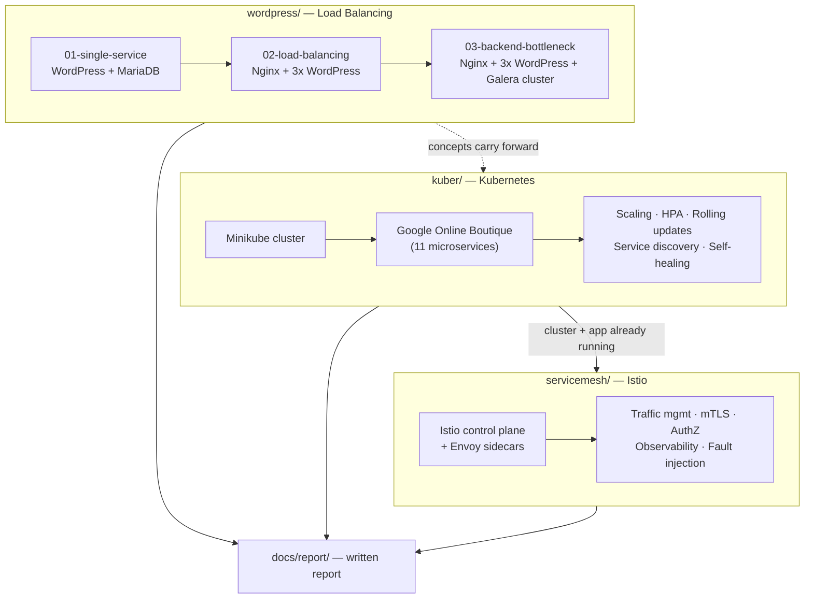

# REAS — Applications and Services Delivery Networks

**Redes de Entrega de Aplicações e Serviços**

Coursework deliverable: progressively build an applications/services delivery stack — from a
single web server, through load-balanced/clustered WordPress, to a Kubernetes-orchestrated
microservices app, to a full Istio service mesh on top of it. Full assignment brief:
[`docs/work/work_instructions.md`](docs/work/work_instructions.md).

## Repository layout

| Folder | Chapter | Status |
|---|---|---|
| [`wordpress/`](wordpress/README.md) | Load testing, horizontal scaling, backend bottleneck | Configs ready, not yet benchmarked |
| [`kuber/`](kuber/README.md) | Container orchestration with Kubernetes | Complete, logged, validated |
| [`servicemesh/`](servicemesh/README.md) | Service mesh with Istio | Scripted, not yet executed |
| [`docs/work/`](docs/work/README.md) | Assignment brief | — |
| [`docs/report/`](docs/report/README.md) | Written report (LaTeX) | In progress |

Each folder above has its own `README.md` with setup/usage instructions, and most have a
`README-nixos.md` + `shell.nix` for NixOS users.

## Quick start

1. **WordPress chapter** — `cd wordpress && ./apply-config.sh` to pick a configuration.
2. **Kubernetes chapter** — `cd kuber && ./cluster.sh start` then `./run-lab.sh`.
3. **Service Mesh chapter** — `cd servicemesh && ./cluster.sh start` then `./run-lab.sh`
   (requires the Kubernetes chapter's cluster to already be up).
