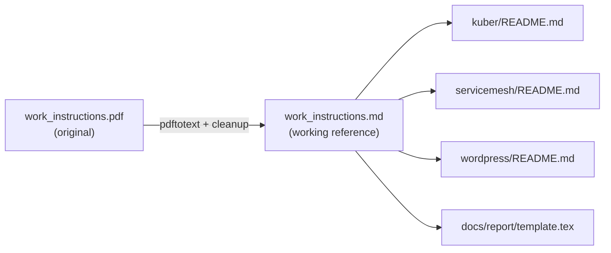

# docs/work/

The assignment brief ("Applications and Services Delivery Networks — Web Performance Project").

- `work_instructions.pdf` — original document, as handed out.
- `work_instructions.md` — Markdown conversion (text-extracted + hand-cleaned), used as the
  working reference throughout this repo since it's easy to `grep`/link into READMEs and the
  report. Each chapter ends with a **"What to include in the report?"** checklist — those are the
  direct spec for what `docs/report/template.tex` needs to cover.

If the brief ever gets revised, re-run the extraction and re-apply the same structure (one
`##`/`###` heading per chapter/sub-section, checklists kept as bullet lists verbatim) so the links
above stay accurate.
