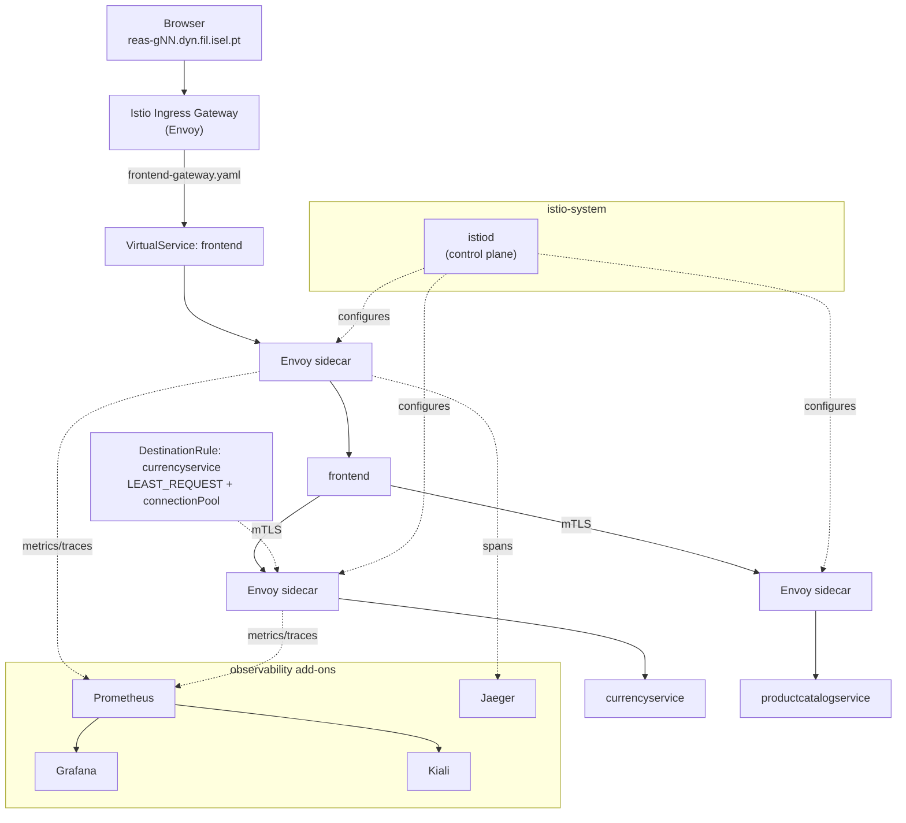

# Service Mesh (Istio) Lab — Ubuntu Guide

Layers Istio on top of the Kubernetes lab's Online Boutique deployment: Envoy sidecars, traffic
management, mTLS, authorization policies, observability, fault injection, and circuit breaking.
Status: scripted (`run-lab.sh`), not yet executed — see
[`../docs/report/template.tex`](../docs/report/template.tex) (`Results → Service Mesh`).



## Prerequisites

- The Kubernetes lab (`kuber/run-lab.sh`, sections 1-2) already run: a minikube cluster with
  Google Online Boutique deployed in the `default` namespace.

---

## 1. Install Istio

```bash
curl -L https://istio.io/downloadIstio | sh -
cd istio-*
export PATH=$PWD/bin:$PATH
```

```bash
istioctl install --set profile=demo -y
kubectl label namespace default istio-injection=enabled
kubectl get pods -n istio-system
istioctl analyze
```

---

## 2. Enable sidecar injection for Online Boutique

```bash
kubectl rollout restart deployment
kubectl get pods -o wide   # expect 2/2 containers per pod (app + istio-proxy)
istioctl analyze
```

---

## 3. External access via Istio Gateway

`frontend-gateway.yaml` (already in this folder):

```yaml
apiVersion: networking.istio.io/v1
kind: Gateway
metadata:
  name: frontend-gateway
  namespace: default
spec:
  selector:
    istio: ingressgateway
  servers:
  - port:
      number: 80
      name: http
      protocol: HTTP
    hosts:
    - "*"
---
apiVersion: networking.istio.io/v1
kind: VirtualService
metadata:
  name: frontend
  namespace: default
spec:
  hosts:
  - "*"
  gateways:
  - frontend-gateway
  http:
  - route:
    - destination:
        host: frontend
        port:
          number: 80
```

```bash
kubectl apply -f frontend-gateway.yaml
```

If the Kubernetes lab's Nginx ingress is still forwarding port 80, remove it first:

```bash
sudo iptables -t nat -D PREROUTING -p tcp --dport 80 -j DNAT --to-destination $(minikube ip):80
kubectl delete ingress boutique-ingress
minikube addons disable ingress
```

Forward external port 80 to the Istio ingress gateway's NodePort instead:

```bash
ISTIO_HTTP_NODEPORT=$(kubectl get svc istio-ingressgateway -n istio-system -o jsonpath='{.spec.ports[?(@.name=="http2")].nodePort}')
sudo iptables -t nat -I PREROUTING 1 -p tcp --dport 80 -j DNAT --to-destination $(minikube ip):$ISTIO_HTTP_NODEPORT
sudo iptables -I FORWARD 1 -p tcp -d $(minikube ip) --dport $ISTIO_HTTP_NODEPORT -j ACCEPT
sudo netfilter-persistent save
```

Access the shop at `http://reas-gNN.dyn.fil.isel.pt`. Verify traffic is flowing through Istio:

```bash
kubectl logs -n istio-system deployment/istio-ingressgateway --tail=50
```

---

## 4. Observability addons (Grafana, Prometheus, Jaeger, Kiali)

Run from inside the Istio release folder:

```bash
kubectl apply -f samples/addons/
kubectl get pods -n istio-system
```

Expose via NodePort and forward:

```bash
kubectl patch svc grafana -n istio-system -p '{"spec":{"type":"NodePort"}}'
kubectl patch svc kiali -n istio-system -p '{"spec":{"type":"NodePort"}}'
kubectl patch svc tracing -n istio-system -p '{"spec":{"type":"NodePort"}}'

GRAFANA_NODEPORT=$(kubectl get svc grafana -n istio-system -o jsonpath='{.spec.ports[0].nodePort}')
KIALI_NODEPORT=$(kubectl get svc kiali -n istio-system -o jsonpath='{.spec.ports[0].nodePort}')
JAEGER_NODEPORT=$(kubectl get svc tracing -n istio-system -o jsonpath='{.spec.ports[0].nodePort}')
MINIKUBE_IP=$(minikube ip)

sudo iptables -t nat -I PREROUTING 1 -p tcp --dport 3000 -j DNAT --to-destination $MINIKUBE_IP:$GRAFANA_NODEPORT
sudo iptables -t nat -I PREROUTING 1 -p tcp --dport 20001 -j DNAT --to-destination $MINIKUBE_IP:$KIALI_NODEPORT
sudo iptables -t nat -I PREROUTING 1 -p tcp --dport 16686 -j DNAT --to-destination $MINIKUBE_IP:$JAEGER_NODEPORT
sudo iptables -I FORWARD 1 -p tcp -d $MINIKUBE_IP --dport $GRAFANA_NODEPORT -j ACCEPT
sudo iptables -I FORWARD 1 -p tcp -d $MINIKUBE_IP --dport $KIALI_NODEPORT -j ACCEPT
sudo iptables -I FORWARD 1 -p tcp -d $MINIKUBE_IP --dport $JAEGER_NODEPORT -j ACCEPT
```

- Grafana: `http://reas-gNN.dyn.fil.isel.pt:3000`
- Kiali: `http://reas-gNN.dyn.fil.isel.pt:20001`
- Jaeger: `http://reas-gNN.dyn.fil.isel.pt:16686`

Jaeger needs the `jaeger` extension provider registered explicitly (demo profile doesn't ship it):

```bash
cat <<EOF > ./tracing.yaml
apiVersion: install.istio.io/v1alpha1
kind: IstioOperator
spec:
  profile: demo
  meshConfig:
    enableTracing: true
    defaultConfig:
      tracing: {}
    extensionProviders:
    - name: jaeger
      opentelemetry:
        port: 4317
        service: jaeger-collector.istio-system.svc.cluster.local
EOF
istioctl install -f ./tracing.yaml -y

kubectl apply -f - <<EOF
apiVersion: telemetry.istio.io/v1
kind: Telemetry
metadata:
  name: mesh-default
  namespace: istio-system
spec:
  tracing:
  - providers:
    - name: jaeger
    randomSamplingPercentage: 100.0
EOF
```

---

## 5. Traffic management

Least-request load balancing for `currencyservice` (`currencyservice-lb.yaml`, already in this
folder):

```bash
kubectl apply -f currencyservice-lb.yaml
kubectl get destinationrule currencyservice -o yaml
kubectl set env deployment/loadgenerator USERS=50
kubectl top pods -l app=currencyservice
```

Canary deployment (frontend v1/v2, 90/10 traffic split):

```bash
kubectl delete virtualservice frontend
kubectl patch deployment frontend -p '{"spec":{"template":{"metadata":{"labels":{"version":"v1"}}}}}'
kubectl get deployment frontend -o yaml | \
  sed -e 's/name: frontend/name: frontend-v2/' \
      -e 's/version: v1/version: v2/' \
      -e 's/:v0\.[0-9.]*$/:v0.10.2/' | \
  kubectl apply -f -
```

`frontend-destinationrule.yaml` and `frontend-virtualservice.yaml` (90/10 split, gateway vs mesh
traffic) — see `docs/work/work_instructions.md` for the full manifests. Apply both, verify the
split in Kiali, then shift weights to 50/50 and finally roll back to 100/0.

---

## 6. Security — mTLS and authorization policies

```bash
kubectl get peerauthentication -A   # none ⇒ PERMISSIVE by default

kubectl apply -f - <<EOF
apiVersion: security.istio.io/v1
kind: PeerAuthentication
metadata:
  name: default
  namespace: default
spec:
  mtls:
    mode: STRICT
EOF

kubectl exec deployment/productcatalogservice -c istio-proxy -- pilot-agent request GET config_dump | grep '"require_client_certificate"'
```

Authorization policy (only `frontend` may call `productcatalogservice`) — see
`docs/work/work_instructions.md` for `productcatalog-authz.yaml`. Verify with Kiali's Security
graph, then `kubectl delete authorizationpolicy productcatalog-access` to restore access.

---

## 7. Fault injection and circuit breaker

- Delay injection: 5s delay on 50% of `currencyservice` requests (`currencyservice-delay.yaml`).
- Abort injection: HTTP 503 on 30% of mesh-internal `frontend` traffic (`frontend-abort.yaml`).
- Circuit breaker: aggressive `DestinationRule` on `frontend`
  (`frontend-circuitbreaker.yaml`), triggered by starving it of CPU/memory under
  `USERS=200` load; monitor via `/stats/prometheus` on the `istio-proxy` container.

Full manifests and monitoring commands are in `docs/work/work_instructions.md`.

---

## 8. Performance overhead

```bash
kubectl top pods --containers      # server vs istio-proxy per pod
kubectl top pods -n istio-system   # control plane cost
```

Grafana PromQL (Explore, `http://reas-gNN.dyn.fil.isel.pt:3000`):

```
sum(rate(istio_requests_total{destination_service="frontend.default.svc.cluster.local"}[1m]))
histogram_quantile(0.95, sum(rate(istio_request_duration_milliseconds_bucket{destination_service="frontend.default.svc.cluster.local"}[1m])) by (le))
```

Re-run after toggling mTLS PERMISSIVE ↔ STRICT to quantify the handshake overhead.

---

## Cleanup

```bash
kubectl delete virtualservice --all
kubectl delete destinationrule --all
kubectl delete authorizationpolicy --all
kubectl label namespace default istio-injection-
kubectl rollout restart deployment
istioctl uninstall --purge -y
```
