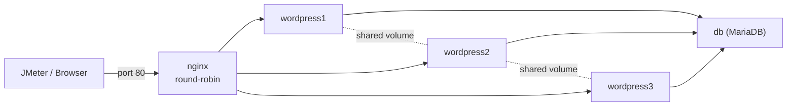

# 02-load-balancing

"Horizontal Scaling and Load Balancing" chapter: 3 WordPress replicas sharing one MariaDB
instance and one `wp_data` volume (so login sessions survive across containers), fronted by
Nginx doing round-robin load balancing.



Apply with `../apply-config.sh` (option 2), or directly:

```bash
docker compose up -d
```

`nginx.conf`'s `upstream` block defaults to round-robin. To compare load-balancing algorithms
(as the brief asks), edit the `upstream backends { ... }` block to add `least_conn;` or
`ip_hash;`, then `docker compose restart nginx` and rerun your JMeter test plan between edits.
