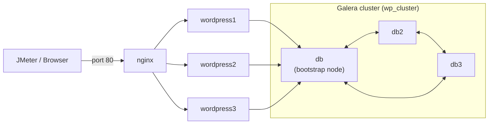

# 03-backend-bottleneck

"Handling Bottleneck at the Backend" chapter: same 3 WordPress replicas + Nginx as
`02-load-balancing`, but the single MariaDB instance is replaced with a 3-node **Galera**
synchronous multi-master cluster, so the database tier is no longer a single point of failure
or a throughput ceiling.



Apply with `../apply-config.sh` (option 3), or directly:

```bash
docker compose up -d
```

**Important:** `db`'s command includes `--wsrep-new-cluster`, which **bootstraps a new cluster**.
It's safe on first start, but if you ever restart `db` while `db2`/`db3` are still running, remove
that flag first — otherwise `db` forks a new cluster UUID instead of rejoining the existing one.
Check cluster health:

```bash
docker compose exec db mysql -uroot -preas2024 -e "SHOW GLOBAL STATUS LIKE 'wsrep_%';"
```
`wsrep_cluster_size` should read `3`.
