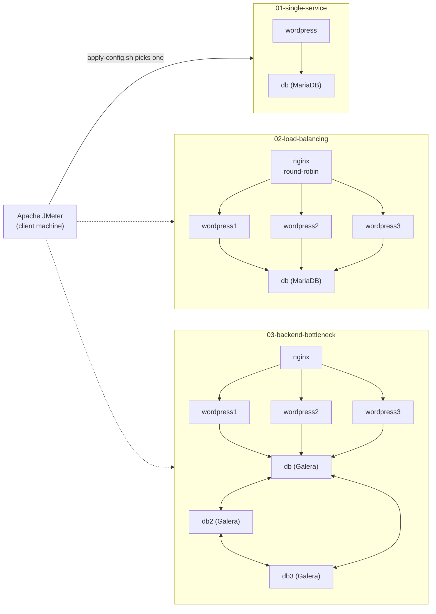

# WordPress Load Balancing Lab — Ubuntu Guide

Three Docker Compose stacks, one per stage of the Load Testing / Horizontal Scaling / Backend
Bottleneck chapters — switch between them with `apply-config.sh`. See each subfolder's own
`README.md` for its specific topology.



## Prerequisites

- Docker installed and running (`docker compose` plugin, or standalone `docker-compose`).
- Apache JMeter installed on your **client** machine (not the VM) — https://jmeter.apache.org.

---

## 1. Configurations available

Each subfolder is a self-contained Docker Compose stack for one stage of the brief:

| Folder | Stage | What it is |
|---|---|---|
| `01-single-service/` | Load Testing (baseline) | Single WordPress + single MariaDB |
| `02-load-balancing/` | Horizontal Scaling and Load Balancing | 3 WordPress replicas behind Nginx (round-robin), port 80 |
| `03-backend-bottleneck/` | Handling Bottleneck at the Backend | 3 WordPress replicas + 3-node MariaDB Galera cluster behind Nginx |

Switch between them with `apply-config.sh` — it stops whatever's currently running, copies the
chosen config into `active/`, and brings it up:

```bash
./apply-config.sh
```

It lists the configs above, you pick one by number, and it handles `docker compose down` /
copy / `docker compose up -d` for you. The currently-active config is tracked in
`active/.current-config`.

---

## 2. Benchmarking with JMeter

From your own machine (the "Load testing host"), point JMeter at
`http://reas-gNN.dyn.fil.isel.pt` (or the VM's IP if testing locally). Reuse the same Test Plan
(threads, ramp-up, loop count) across all three configurations so results are comparable. Record,
per configuration:

- Requests handled per second;
- Average response time;
- Error rate %;
- Resource usage on the containers (`docker stats`).

Suggested sequence:

1. `./apply-config.sh` → pick `01-single-service` → run your JMeter test plan → save the HTML report.
2. `./apply-config.sh` → pick `02-load-balancing` → rerun the same test plan → compare.
3. Experiment with Nginx LB algorithms in `02-load-balancing/nginx.conf` (default is round-robin;
   try `least_conn;` or `ip_hash;` in the `upstream` block) and rerun between edits.
4. `./apply-config.sh` → pick `03-backend-bottleneck` → rerun — this isolates the database tier as
   the bottleneck once the web tier is already scaled out.

---

## 3. Galera cluster notes (`03-backend-bottleneck`)

The `db` service bootstraps the cluster with `--wsrep-new-cluster`; `db2`/`db3` join via
`wsrep_cluster_address: gcomm://db,db2,db3`. **Important:** if you ever restart `db` while
`db2`/`db3` are still running, remove `--wsrep-new-cluster` first — otherwise `db` creates a brand
new cluster UUID instead of rejoining the existing one. Check cluster health with:

```bash
docker compose -f active/docker-compose.yml exec db mysql -uroot -preas2024 -e "SHOW GLOBAL STATUS LIKE 'wsrep_%';"
```
(`wsrep_cluster_size` should read `3`.)

---

## Cleanup

```bash
docker compose -f active/docker-compose.yml down -v   # -v also drops db_data/wp_data volumes
```
